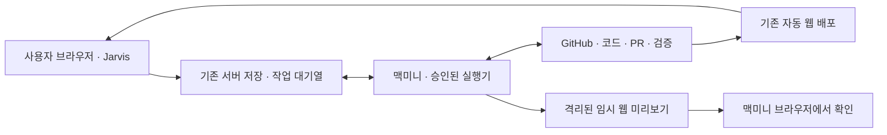

# GitHub에서 수정된 웹 화면까지 — 맥미니 실행 기획안

## 목표

GitHub를 연결한 뒤 Jarvis에서 요청하고, 작업한 코드의 화면을 바로 열어 확인한다. 사용자가 프로젝트마다 소스를 다운로드하고 서버 실행 명령을 찾는 일을 줄인다. 코드 변경, 검사, GitHub 반영, 웹 화면 준비를 각각 확인하며 코드 저장만으로 화면 반영을 완료 처리하지 않는다.

## 구성



- Vercel: 기존 Jarvis 웹 화면과 API를 유지한다.
- Supabase: 기존 기기 승인, 영역별 기록, 작업 요청과 결과를 유지한다.
- GitHub: 코드·PR·테스트·배포 기록의 기준이다. 사적 요청이나 업무 원본을 PR 본문에 올리지 않는다.
- 맥미니: 기존 구독 CLI로 요청한 작업을 수행하고 필요하면 별도의 컨테이너에서 화면을 실행한다. 새 유료 클라우드 서버를 만들지 않는다.

## 사용자 흐름

1. 프로젝트에 GitHub 저장소를 연결한다. 기존 점검으로 구조·현황·배포 주소를 확인한다.
2. **화면 준비**를 누르면 현재 기본 브랜치의 커밋을 고정하고, 그 커밋의 성공한 GitHub 배포 주소를 찾는다. 모델은 호출하지 않고 코드나 GitHub 설정도 변경하지 않는다.
3. 배포가 없으면 맥미니에서 임시 미리보기를 만든다. 준비가 확인되면 **맥미니에서 화면 열기**를 표시한다.
4. Jarvis에서 변경 내용을 요청한다. 맥미니가 격리 작업 폴더에서 수정·검사하고 PR을 작성한다. 기존에 선택한 PR 검토 또는 검증 후 병합 범위를 유지한다.
5. 수정 커밋 또는 실제 병합 커밋의 화면을 준비해 결과에 붙인다. CI 실패와 화면 준비 성공은 별개이며, 미리보기를 열었다고 운영 배포를 완료 처리하지 않는다.
6. 사용자가 실제 화면을 보고 같은 프로젝트에서 다음 수정을 요청한다. 긴 검사 로그·이전 대화·화면 안내는 접어서 표시한다.

## 화면 상태

| 상태 | 표시와 행동 |
| --- | --- |
| 요청 저장·대기 | 새 실행기가 가져갈 때까지 요청 보존. 중복 버튼 전송 방지 |
| 웹 배포 확인 | 해당 커밋의 성공한 배포 기록·주소·확인 시각 표시 |
| 맥미니 미리보기 준비 | 실행한 맥미니에서 여는 버튼, 커밋, 확인·만료 시각 표시 |
| 지원 조건 부족·실행 실패 | 실제 이유를 표시하고 코드·PR·기존 데이터를 보존 |
| 만료 | 이전 열기 버튼을 숨기고 화면 준비로 새 요청 가능 |

기존 홈페이지/README 링크는 일반 바로가기로 유지한다. 해당 수정 커밋의 배포 근거가 없으면 ‘이번 변경이 반영된 화면’으로 격상하지 않는다. 미리보기 결과가 프로젝트 목표·현재 상황 요약을 덮어쓰지 않는다.

## 이번 지원 범위

- 정적 HTML: 루트 또는 `public/index.html`.
- Node 앱: `npm start`, 또는 Vite의 `build`/`preview` 명령. 외부 의존성이 있으면 공개 npm 레지스트리 기반 잠금 파일이 필요하다.
- Node 24 컨테이너에서 필요한 설치·빌드 후 실행한다. npm 설치 훅은 실행하지 않는다. 빌드와 실행에서 운영 비밀 설정·사용자 데이터·CLI 인증을 주입하지 않는다.
- 실제 AI·DB·외부 API가 필요한 기능은 미리보기만으로 연결되지 않는다. 환경 설정이나 다른 언어/모노레포 실행 규격이 필요하면 준비 불가 이유를 표시한다.
- GitHub Pages를 새로 켜거나 Vercel 프로젝트를 자동 생성하지 않는다. 기존에 성공한 배포만 사용한다. 새로운 공개 배포·유료 서비스·접근 변경은 별도 구성 범위다.

## 격리·수명·복구

- 허용된 추적 파일만 별도 빌드 폴더로 복사한다. `.env`, 인증 파일, 사용자 자료, 데이터 폴더, 심볼릭 링크는 제외한다. 모델이 지정한 임의 명령을 호스트에서 실행하지 않는다.
- 미리보기 컨테이너는 일반 사용자, 읽기 전용 루트, 제한된 CPU·메모리·프로세스, 임시 데이터 폴더, 외부 네트워크 없음으로 실행한다. 호스트 폴더·Docker 소켓을 마운트하지 않는다.
- 맥미니의 루프백 전달기는 고정된 `docker exec` 명령의 표준 입출력을 통해 컨테이너 웹 서버에 연결한다. LAN/인터넷 포트를 공개하지 않는다. 다른 실행의 응답과 혼동하지 않도록 미리보기 식별 응답을 확인한다.
- 미리보기는 2시간 후 종료한다. 실행기 종료·재시작 시 링크가 끊길 수 있으므로 실제 사용 시 다시 준비할 수 있다. 임시 데이터는 운영 데이터·업무 결과 보관소가 아니다.
- 같은 프로젝트는 새 화면이 준비된 뒤 이전 미리보기를 종료한다. 다른 프로젝트의 미리보기 3개가 이미 실행 중이면 추가 준비를 제한한다. 각 실행은 CPU 1개·메모리 1GB·임시 저장 256MB 범위이며 파일 수·크기도 제한한다.
- 기존 작업의 기기·임대·취소·중복 전달 방어는 유지한다. 기존 실행기는 새 ‘화면 준비’ 요청을 가져가지 않는다. 결과 전달 재시도는 모델과 코드 수정을 다시 실행하지 않는다.

## 맥미니 최초 설정

실제 맥미니 터미널에서 수행한다. 이 채팅을 맥미니에서 여는 것과 실행 환경 연결은 별개다.

1. 기존 Node 24 이상, GitHub CLI 로그인, Codex ChatGPT 구독 로그인을 사용한다.
2. Docker Desktop 또는 Colima 등 Docker 호환 엔진을 켠다. 필요하면 조직에서 사용할 수 있는 설치·라이선스 조건에 맞는 엔진을 준비한다. 컨테이너 실행 환경의 설치를 완료했다고 추정하지 않는다.
3. 기존 수동 실행기는 Ctrl+C로 종료한다. Jarvis 설정의 **맥미니 설치 파일 받기**를 누른 뒤 기존 `jarvis-runner.json`과 같은 폴더에서 다음을 실행한다.

```sh
cd ~/Downloads
node jarvis-mac.mjs install --config jarvis-runner.json
```

설치기는 배포된 파일의 해시를 확인하고 사용자 전용 `~/Library/Application Support/Jarvis`에 설치한다. `app.jarvis.runner` LaunchAgent가 사용자 로그인 후 실행기를 시작하고 실행 중 절전을 방지한다. 기존 기본 위치의 기기 승인·작업 이력과 같은 origin/프로젝트 범위를 사용한다. 사용자 인증 파일은 복사하지 않는다.

재부팅 뒤 macOS 로그인과 Docker 실행이 필요하다. FileVault 잠금 해제 전 실행이나 로그아웃 상태의 서비스 실행을 보장하지 않는다. 자동 시작 중단은 `node jarvis-mac.mjs stop`, 준비 상태 확인은 `node jarvis-mac.mjs check`이다. 중단해도 업무 데이터·설정·승인·이력은 삭제하지 않는다.

## 다른 기기에서의 이용

Jarvis와 기존 웹 배포 주소는 노트북에서도 사용할 수 있다. 맥미니의 임시 미리보기 주소는 **맥미니에서만** 사용한다. 노트북에서 그 주소를 열면 노트북 자신을 가리키므로 원격 링크로 표시하지 않는다.

맥미니 미리보기를 외부 노트북에서도 열려면 별도로 인증된 원격 접속을 연결해야 한다. Tailscale 등 사설 연결을 검토하되 현재 연결 여부·접근 정책을 확인한 뒤 진행한다. 공개 터널이나 인증 없는 포트 공개를 자동으로 켜지 않는다. 이것은 이번 로컬 화면 확인 기능과 구분한다.

## 완료 검증

- 합성 저장소에서 실제 컨테이너 기동 → HTML 응답 → 브라우저 버튼 동작 확인.
- Node 서버의 임시 데이터 읽기/쓰기 및 호스트 비밀·외부 네트워크 분리 확인.
- 다른 커밋·실패한 배포를 완료 주소로 인정하지 않음.
- 화면 준비는 모델 호출·PR 생성 없이 처리하고 구형 실행기는 가져가지 않음.
- 모바일 320px, 대기/실패/만료·이력·영역 분리, 기존 저장·작업 회귀 확인.
- 실제 맥미니 설치·구독 호출·launchd 재시작은 맥미니에서 별도 확인. 클라우드 Linux의 합성 검증을 실제 사용자 기기의 검증으로 주장하지 않음.
